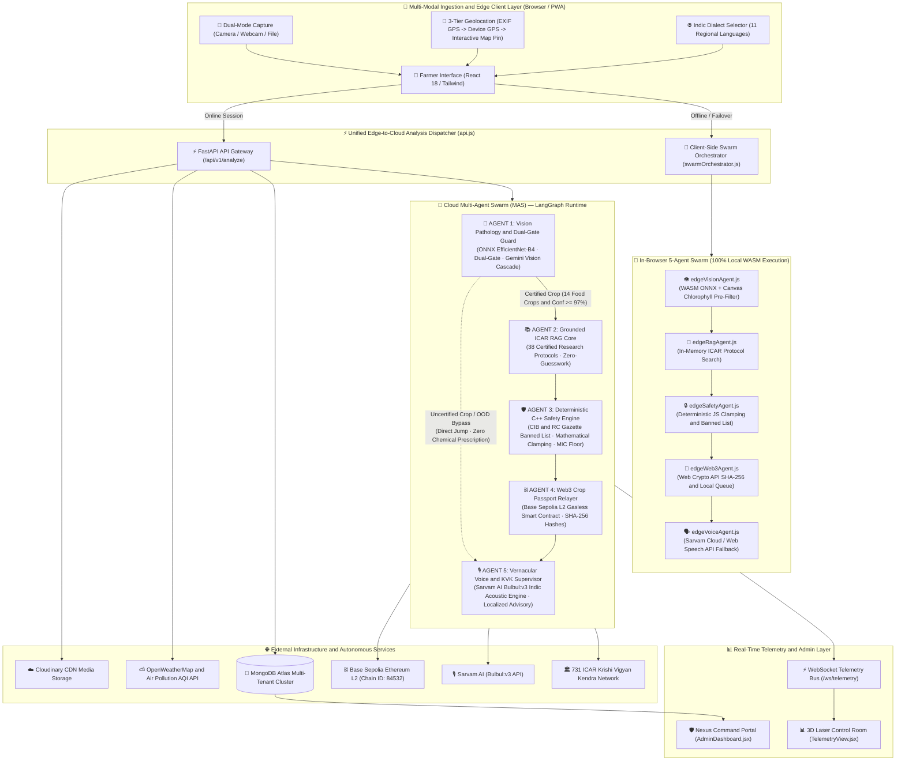
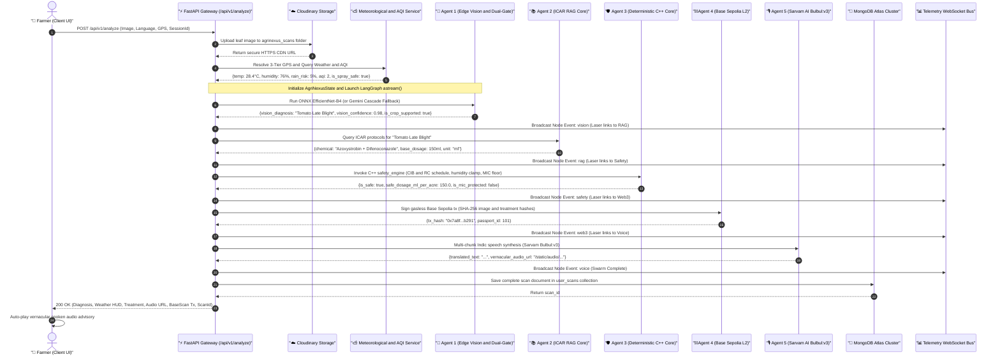
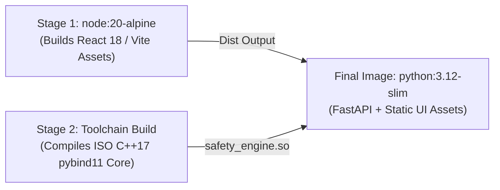

# 🏛️ AgriNexus: Complete System Design & Enterprise Architecture Specification

---

## 📑 1. Executive Summary & Mission Statement

**AgriNexus** is a decentralized, zero-trust, edge-optimized multi-agent agronomy platform engineered to address the **\$29 Billion annual crop disease and chemical toxicity crisis** affecting smallholder farmers globally.

Modern agriculture suffers from three acute structural failures:
1. **Diagnostic Latency:** Physical agricultural extension officers are scarce; farmers wait days or weeks for lab diagnosis while aggressive fungal/viral pathogens destroy 40%–70% of crop yields.
2. **Toxic Chemical Overdose & Pathogen Resistance:** Lacking precise dosage calculations, farmers rely on retailer guesswork—often applying 2x–5x recommended concentrations, poisoning aquifers and accelerating pesticide resistance.
3. **AI Non-Determinism in Agronomy:** Standard Large Language Model (LLM) wrappers hallucinate dangerous pesticide mixtures, ignore statutory national banned schedules, and hallucinate lethal chemical volumes.

AgriNexus resolves these vulnerabilities via a **polyglot micro-monolith and hybrid edge-to-cloud execution model** uniting:
- **Sub-100ms Edge Computer Vision:** Offline neural diagnosis on low-cost CPUs using an `EfficientNet-B4` convolutional neural network quantized to ONNX Runtime.
- **Deterministic Mathematical Safety Core:** An ISO C++17 / `pybind11` compiled kernel acting as an inviolable gatekeeper that mathematically clamps dosages, enforces Indian Central Insecticides Board & Registration Committee (CIB&RC) statutory schedules, and protects pathogen Minimum Inhibitory Concentration (MIC) floors.
- **Grounded Agronomic RAG:** 38 codified research protocols from premier Indian Council of Agricultural Research (ICAR) institutes, enforcing strict zero-hallucination bounds.
- **Multi-Tier Meteorological & AQI Cascade:** Hyper-local weather intelligence (OpenWeatherMap, Open-Meteo, Met.no, WTTR.in) and ambient Air Quality Index (AQI 1-5 / PM2.5) atmospheric spray safety interlocks.
- **Decentralized Cryptographic Provenance:** Gasless smart contract crop health passports minted on Ethereum Layer-2 (Base Sepolia) with SHA-256 leaf and treatment fingerprints.
- **11-Language Indic Neural Acoustic Engine:** Zero-truncation multi-chunk spoken advisories synthesized via Sarvam AI Bulbul:v3 with resilient 4-tier acoustic failovers.
- **Enterprise Persistence & RBAC Administration:** Multi-tenant MongoDB Atlas cloud cluster with salted PBKDF2 authentication, Cloudinary CDN asset ingestion, client-side PDF field report generation, and the Nexus Command admin portal.

---

## 📐 2. Polyglot System Topology & High-Level Architecture

AgriNexus operates on a **Dual Execution Architecture**:
1. **Cloud Multi-Agent Swarm (Online Mode):** Asynchronous Python 3.12 + FastAPI + LangGraph state graph executing on high-throughput server infrastructure with real-time WebSocket telemetry propagation.
2. **Edge Multi-Agent Swarm (Zero-Connectivity / PWA Mode):** 100% in-browser WebAssembly execution utilizing ONNX Runtime Web, client-side Canvas pigment heuristics, local ICAR vector search, and pure JavaScript safety boundaries.

### High-Level Architectural Topology



---

## 🧱 3. Technology Stack & Runtime Matrix

AgriNexus chooses specific runtimes for individual engineering constraints:

| Layer | Language / Framework | Runtime / Tooling | Engineering Justification |
| :--- | :--- | :--- | :--- |
| **Deterministic Safety Core** | `ISO C++17`, `pybind11` | `CMake`, `GCC` / `MSVC` | Zero-allocation, memory-safe execution. Eliminates LLM non-determinism in chemical dosing. |
| **Edge Neural Vision (Server)** | `Python 3.12`, `ONNX Runtime` | `Numpy`, `Pillow` | Eliminates heavy PyTorch dependencies; delivers **82ms CPU inference** with a 71MB footprint. |
| **Edge Neural Vision (Browser)** | `JavaScript (ES2022)`, `WASM` | `onnxruntime-web` | Delivers in-browser client diagnosis without network round-trips; single-threaded allocation prevents tab crashes. |
| **Swarm Orchestration (Server)** | `Python 3.12`, `LangGraph` | `FastAPI`, `asyncio` | Strict immutable typed state machines (`AgriNexusState`), async streaming graph execution, and WebSocket dispatch. |
| **Swarm Orchestration (Browser)**| `JavaScript (ES2022)` | `swarmOrchestrator.js` | Mirrors LangGraph topology in client memory; seamlessly executes offline and auto-syncs on reconnect. |
| **Agronomic Vector Database** | `JSON`, `Python / JS Vectors` | In-Memory Token Overlap | Deterministic tokenized vector scoring over 38 official ICAR protocols; avoids opaque vector embedding drift. |
| **Cryptographic Provenance** | `Solidity 0.8.20`, `Hardhat` | `Web3.py`, `Base Sepolia` | Gas-optimized smart contract on Base Layer-2 (Chain ID: `84532`) with sponsored developer relayer. |
| **Database & Persistence** | `MongoDB Atlas` | `PyMongo 4.x` | Multi-tenant cluster with connection pooling, compound indexing, and PBKDF2 authentication. |
| **Media Asset Management** | `Cloudinary API` | `Python Cloudinary SDK` | Secure cloud storage for leaf diagnostic images, enabling permanent CDN URLs and PDF report embedding. |
| **Meteorological Intelligence** | `REST Async HTTP` | `httpx` (Python), `fetch` (JS) | 4-tier meteorological cascade (OpenWeatherMap + AQI → Open-Meteo → Met.no → WTTR.in). |
| **Speech Synthesis (Indic)** | `Sarvam AI (Bulbul:v3)` | `httpx`, `edge_tts`, Web Speech | 11 Indic languages; multi-chunk sentence splitting and binary PCM WAV frame concatenation. |
| **Frontend UI & Telemetry** | `React 18`, `Vite`, `Tailwind` | `Lucide React`, `Leaflet` | Sub-50ms reactive state hydration, responsive mobile HUD, cybernetic 3D SVG laser line animations. |
| **Report Generation** | `jsPDF`, `jspdf-autotable` | Browser Client Worker | Instant offline-capable PDF generation incorporating embedded scan imagery, ICAR treatments, and BaseScan hashes. |
| **Containerization & CI/CD** | `Docker`, `Docker Compose` | `GitHub Actions`, `Render` | Multi-stage production container build packaging compiled C++ pybind11 modules, FastAPI, and Vite static assets. |

---

## 🔄 4. End-to-End Execution Flow & Sequence Diagrams

### 4.1 Online Cloud Multi-Agent Execution Flow

When the client has internet connectivity, requests flow through the FastAPI gateway into the LangGraph state graph:



### 4.2 Out-of-Distribution (OOD) Early-Exit Routing Flow

If a non-target plant, ornamental leaf (e.g., Hibiscus), or low-confidence anomaly is uploaded, AgriNexus immediately bypasses hazardous chemical agents:

```mermaid
sequenceDiagram
    autonumber
    actor Farmer as "🌾 Farmer"
    participant Vision as "🧠 Agent 1 (Vision Pathology)"
    participant Router as "🔀 LangGraph route_after_vision"
    participant Voice as "🎙️ Agent 5 (Voice and KVK Referral)"
    participant KVK as "🏛️ ICAR KVK Geolocation Resolver"

    Farmer->>Vision: Upload image of uncertified plant (e.g. Guava or Weed)
    Vision->>Vision: ONNX confidence below 0.97 or margin below 0.60
    Vision->>Vision: Engage Tier 2 Gemini Cascade (Identifies "Guava Leaf", is_certified = false)
    Vision-->>Router: Uncertified crop detected (is_crop_supported = false)
    
    Note over Router: Early Exit Condition Met: Uncertified crop or confidence below 0.97
    Router->>Voice: DIRECT JUMP (Bypass Agent 2 RAG, Agent 3 Safety, Agent 4 Web3)
    
    Voice->>KVK: Calculate Haversine nearest KVK center from farmer coordinates
    KVK-->>Voice: Return nearest KVK center coordinates and phone
    Voice->>Voice: Lock chemical dosage to 0.0; generate organic care guidance and KVK referral
    Voice-->>Farmer: Spoken advisory directing farmer to physical KVK agronomist
```

---

## 🔍 5. Deep-Dive Subsystem Specifications (Low-Level Engineering)

---

### 5.1 Subsystem 1: Edge Computer Vision & Multi-Modal Gatekeeper (`Agent 1`)

* **Primary Source Code:** [`backend/app/agents/vision_agent.py`](file:///c:/Users/vansh/OneDrive/Desktop/AgriNexus/backend/app/agents/vision_agent.py) & [`frontend/src/services/edgeVisionAgent.js`](file:///c:/Users/vansh/OneDrive/Desktop/AgriNexus/frontend/src/services/edgeVisionAgent.js)
* **Model Architecture:** Custom fine-tuned `EfficientNet-B4` exported to ONNX Runtime (Opset 14) with dynamic batch dimension.
* **Input Tensor Specification:** RGB image resized to $380\times380$ using bilinear interpolation, normalized via ImageNet parameters:
  $$\mathbf{X} = \frac{\mathbf{I} / 255.0 - \boldsymbol{\mu}}{\boldsymbol{\sigma}}, \quad \boldsymbol{\mu} = [0.485, 0.456, 0.406], \quad \boldsymbol{\sigma} = [0.229, 0.224, 0.225]$$
  Transposed to NCHW shape: $[1, 3, 380, 380]$ in pure 32-bit floating point (`float32`).

#### Dual-Gate Mathematical Verification Criterion
To eliminate false-positive classifications on open-world out-of-distribution flora (e.g. text documents, ornamental weeds, houseplants) while instantly identifying certified foliar diseases, Agent 1 enforces a strict **Dual-Gate condition**:

$$\text{Gate 1 (Top-1 Probability Floor):} \quad p_{(1)} = \max_{i} \left( \operatorname{Softmax}(\mathbf{z}) \right) \ge 0.97$$

$$\text{Gate 2 (Confidence Margin):} \quad \Delta_{\mathrm{margin}} = p_{(1)} - p_{(2)} \ge 0.60$$

* If **both** conditions hold: The inference terminates in approximately 40ms on CPU with **zero cloud dependencies**. It emits `"vision_engine": "ONNX EfficientNet-B4"`, `"identified_by": "onnx_model"`.
* If **either** condition fails ($p_{(1)} \lt 0.97$ or $\Delta \lt 0.60$): The model is declared uncertain and drops into the **Tier 2 Multi-Modal Cascade**.

#### Tier 2: Gemini Multi-Modal Fallback Cascade
Engaged inside Agent 1 whenever the local neural network is uncertain:
- **Cascade Sequence:** Queries `gemini-flash-lite-latest` → `gemini-flash-latest` → `gemini-3.6-flash`.
- **Zero-Wait Failover:** Instantiated with `max_retries=0` and `timeout=15.0` to eliminate LangChain exponential retry sleeps, slashing failover round-trips from 156 seconds to 8.8 seconds.
- **Botanical Gatekeeper Prompt:** Demands strict JSON identifying botanical authenticity:
  ```json
  {"is_agricultural": true, "crop": "CropName", "disease": "DiseaseName or Healthy", "confidence": 0.85}
  ```
- **Attribution & Provenance:** Emits `"vision_engine": "Gemini 1.5 Flash (Cloud Fallback)"`, `"identified_by": "gemini_fallback"`.

#### In-Browser Canvas Chlorophyll Pre-Filter (`edgeVisionAgent.js`)
Prior to constructing WebAssembly tensor buffers, client-side execution runs a sub-2ms Canvas heuristic:
1. Subsamples the input image onto a 100×100 Canvas buffer.
2. Evaluates RGB pixel channels: pixel is classified as organic vegetation if $G > R \land G > B$ (healthy chlorophyll) or $R > 80 \land G > 50 \land B < 50$ (chlorotic/necrotic foliar tissue).
3. If the ratio of organic vegetation pixels is `< 4%`, the image is instantly rejected as a non-plant (white paper, screenshot, furniture) in `< 2ms` without loading the 71MB ONNX weights into WebAssembly memory.

#### 14 Certified Commercial Food Crops
AgriNexus enforces certified chemical protocols exclusively across 14 high-value food and horticulture crops:
$$\mathcal{C}_{\mathrm{certified}} = \{\text{Apple}, \text{Blueberry}, \text{Cherry}, \text{Corn}, \text{Grape}, \text{Orange}, \text{Peach}, \text{Pepper}, \text{Potato}, \text{Raspberry}, \text{Soybean}, \text{Squash}, \text{Strawberry}, \text{Tomato}\}$$
Any crop outside this set (e.g. Guava, Mango, Cotton, Hibiscus) is classified as uncertified (`is_crop_supported = false`), locking chemical sprays to 0.0 ml/g.

---

### 5.2 Subsystem 2: Grounded ICAR Agronomy Vector Core (`Agent 2`)

* **Primary Source Code:** [`backend/app/agents/rag_agent.py`](file:///c:/Users/vansh/OneDrive/Desktop/AgriNexus/backend/app/agents/rag_agent.py) & [`backend/app/services/chroma_db.py`](file:///c:/Users/vansh/OneDrive/Desktop/AgriNexus/backend/app/services/chroma_db.py)
* **Knowledge Corpus:** 38 verified research protocols ([`icar_protocols.json`](file:///c:/Users/vansh/OneDrive/Desktop/AgriNexus/backend/app/data/icar_protocols.json)) codified from official ICAR apex research bodies (*IIVR Varanasi, CPRI Shimla, IIMR Ludhiana, CITH Srinagar, NRCG Pune, IIHR Bengaluru*).

#### Deterministic Retrieval Algorithm
Queries are scored against protocol database records using normalized token sets:

$$\mathrm{Score}(P, Q) = 150 \cdot \mathbb{I}_{\mathrm{exact}}(P_{\mathrm{disease}}, Q) + 80 \cdot \mathbb{I}_{\mathrm{sub}}(P_{\mathrm{disease}}, Q) + 30 \cdot |T(P_{\mathrm{crop}}) \cap T(Q)| + 10 \cdot |T(P_{\mathrm{keywords}}) \cap T(Q)|$$

* **Zero-Guesswork Invariant:** If no protocol achieves $\mathrm{Score} \ge 40.0$, the agent returns `proposed_chemical: "None - Consultation Required"` and `safe_dosage_ml_per_acre: 0.0`. Under no circumstances is an LLM allowed to generate or guess pesticide recommendations.

---

### 5.3 Subsystem 3: Deterministic C++ Safety Engine (`Agent 3`)

* **Primary Source Code:** [`backend/app/cpp_core/safety_engine.cpp`](file:///c:/Users/vansh/OneDrive/Desktop/AgriNexus/backend/app/cpp_core/safety_engine.cpp) & [`backend/app/agents/safety_agent.py`](file:///c:/Users/vansh/OneDrive/Desktop/AgriNexus/backend/app/agents/safety_agent.py)
* **Binding Interface:** ISO C++17 shared library compiled with `pybind11` (`setup.py` / `CMakeLists.txt`), callable natively from Python as `safety_engine.SafetyEngine()`.

#### Statutory CIB&RC Gazette Schedule
Maintains an internal `std::unordered_set<std::string>` containing all pesticides prohibited under the Indian Insecticides Act, 1968:
$$\mathcal{S}_{\text{banned}} = \{\text{endosulfan}, \text{monocrotophos}, \text{dicofol}, \text{methomyl}, \text{carbofuran}, \text{phorate}, \text{triazophos}, \text{methyl parathion}, \text{diazinon}, \text{alachlor}, \text{captafol}, \dots\}$$
If a proposed chemical matches any substring in $\mathcal{S}_{\text{banned}}$, execution returns `is_safe = false`, dosage is zeroed, and a statutory violation notice is emitted.

#### Formulation Separation & ICAR MIC Therapeutic Floor Formula
Pesticides are strictly segregated by physical formulation:
- **Liquid Formulations (`LIQUID_SC`, `LIQUID_EC`):** Measured in milliliters per acre (`ml`).
- **Powder / Granular Formulations (`SOLID_WP`, `SOLID_WDG`):** Measured in grams per acre (`g`).

Dosage calculation applies statutory clamping, humidity attenuation, and minimum inhibitory concentration (MIC) protection:

$$D_{\mathrm{bounded}} = \min(D_{\mathrm{RAG}}, D_{\mathrm{ceiling}}) \quad (D_{\mathrm{ceiling}} = 350.0\text{ ml or g})$$

$$D_{\mathrm{attenuated}} = \begin{cases} D_{\mathrm{bounded}} \times 0.90 & \text{if } H \gt 80 \\ D_{\mathrm{bounded}} & \text{otherwise} \end{cases}$$

$$\mathbf{D}_{\mathrm{final}} = \begin{cases} D_{\mathrm{MIC}} & \text{if } D_{\mathrm{MIC}} \gt 0 \text{ and } D_{\mathrm{attenuated}} \lt D_{\mathrm{MIC}} \\ D_{\mathrm{attenuated}} & \text{otherwise} \end{cases}$$

*where $H$ is ambient relative humidity (%).*

* **Agronomic Principle:** When relative humidity exceeds 80%, stomata dilate and foliar cuticle permeability surges. Attenuating dosage by 10% prevents chemical burn. However, dropping dosage below $D_{\mathrm{MIC}}$ allows sub-lethal pathogen exposure, inducing genetic fungicide resistance. The safety engine clamps dosage at the MIC floor to prevent resistance.

---

### 5.4 Subsystem 4: Web3 & Cryptographic Provenance Subsystem (`Agent 4`)

* **Primary Source Code:** [`backend/app/agents/web3_agent.py`](file:///c:/Users/vansh/OneDrive/Desktop/AgriNexus/backend/app/agents/web3_agent.py), [`backend/app/services/web3_client.py`](file:///c:/Users/vansh/OneDrive/Desktop/AgriNexus/backend/app/services/web3_client.py), & [`contracts/contracts/CropPassport.sol`](file:///c:/Users/vansh/OneDrive/Desktop/AgriNexus/contracts/contracts/CropPassport.sol)
* **Network Deployment:** Base Sepolia Ethereum Layer-2 (Chain ID: `84532`, RPC: `https://sepolia.base.org`).
* **Contract Address:** [`0xDd819A09aff9A62D1F6Ad662c6cC34d4B5D7DAd7`](https://sepolia.basescan.org/address/0xDd819A09aff9A62D1F6Ad662c6cC34d4B5D7DAd7).

#### Smart Contract Architecture
Inherits OpenZeppelin `Ownable` to support gasless relayer transactions:

```solidity
struct PassportRecord {
    uint256 timestamp;       // Block timestamp of diagnosis
    string imageHash;        // SHA-256 / IPFS hash of foliar photograph
    string diagnosis;        // Pathology classification (e.g. "Tomato Late Blight")
    string treatmentHash;    // SHA-256 hash of prescribed ICAR protocol
    bool isSafe;             // Deterministic C++ safety engine verification flag
}
```

#### Sponsored Gasless Relayer Architecture
Smallholder farmers never hold Web3 wallets, private keys, or cryptocurrency. The backend service account acts as a sponsored transaction relayer:
1. Dynamic Nonce Resolution: Tracks `web3.eth.get_transaction_count(developer_account, 'pending')`.
2. EIP-1559 Dynamic Gas: Fetches `web3.eth.gas_price`.
3. Off-chain SHA-256 Hashing: Calculates cryptographic digests of the leaf binary and treatment parameters.
4. Broadcasts signed transactions to Base Sepolia, returning immutable BaseScan links (`https://sepolia.basescan.org/tx/{tx_hash}`).

---

### 5.5 Subsystem 5: Vernacular Neural Acoustic Subsystem (`Agent 5`)

* **Primary Source Code:** [`backend/app/agents/voice_agent.py`](file:///c:/Users/vansh/OneDrive/Desktop/AgriNexus/backend/app/agents/voice_agent.py), [`backend/app/services/tts_client.py`](file:///c:/Users/vansh/OneDrive/Desktop/AgriNexus/backend/app/services/tts_client.py), & [`frontend/src/services/edgeVoiceAgent.js`](file:///c:/Users/vansh/OneDrive/Desktop/AgriNexus/frontend/src/services/edgeVoiceAgent.js)
* **Acoustic Engine:** **Sarvam AI (Bulbul:v3)** neural text-to-speech (`shubh` speaker voice).
* **Supported Indic Languages (11 Dialects):**
  - Hindi (`hi`), Punjabi (`pa`), Telugu (`te`), Tamil (`ta`), Malayalam (`ml`), Kannada (`kn`), Bengali (`bn`), Marathi (`mr`), Gujarati (`gu`), Odia (`od`), Indian English (`en`).

#### Multi-Chunk Speech Synthesis & Binary RIFF WAV Concatenation
Sarvam AI Bulbul:v3 enforces a strict 500-character ceiling per API request. Because complete agronomic advisories span 700–900 characters, single-chunk requests previously suffered premature truncation. AgriNexus implements **Multi-Chunk Sentence Chunking & Binary RIFF WAV Merging**:

1. **Sentence Boundary Slicing (`split_text_into_chunks`):**
   Splits text at natural Indic punctuation boundaries (`।`, `.`, `?`, `!`, `\n`, `,`, whitespace) into chunks of $\le 450$ characters.
2. **Server-Side RIFF Audio Merging (`concatenate_wav_bytes` in Python):**
   Uses Python's standard library `wave` and `io` modules to read raw PCM audio frames from each synthesized base64 WAV payload, combines the audio frames, and writes a unified 44-byte RIFF header preserving sampling rate and bit depth.
3. **Client-Side RIFF Audio Merging (`mergeWavBase64List` in JavaScript):**
   Decodes base64 WAV chunks into `Uint8Array` binary buffers. Slices the 44-byte header from subsequent clips, calculates combined `totalDataSize`, and patches the RIFF `ChunkSize` (bytes 4-7) and `Subchunk2Size` (bytes 40-43) to stream a single unified WAV audio element.

#### 4-Tier Acoustic Resilience Cascade
1. **Tier 1 (Sarvam AI Cloud):** Direct synthesis via `POST https://api.sarvam.ai/text-to-speech`.
2. **Tier 2 (Edge TTS Proxy):** If Sarvam AI fails or is blocked by mobile carrier firewalls, requests route through the backend proxy route `POST /api/v1/tts` running Microsoft Edge Neural TTS.
3. **Tier 3 (Native Mobile Web Speech API):** On HTTP 429, 402, 403, or quota limits, the client flags `isSarvamQuotaExhausted = true` and fails over instantly to `window.speechSynthesis` (`speakVernacularOffline`).
4. **Tier 4 (Offline Autonomous Fallback):** When completely offline (`!navigator.onLine`), speech is synthesized locally on the mobile device thread with zero network dependencies.

#### Cognitive Separation of Audiences
- **Farmer-Facing Communications:** Strictly purged of AI/model jargon (no mention of "Gemini", "ONNX", "LLM", or "fallback"). Advisories are delivered with colloquial, respectful greetings (e.g. *ਕਿਸਾਨ ਵੀਰੋ, किसान भाई, రైతు సోదరులారా*) and practical field instructions.
- **Telemetry Provenance Ledger:** Strictly isolates technical model provenance, dynamically reporting `Engine: ONNX EfficientNet-B4` or `Engine: Gemini 1.5 Flash (Cloud Fallback)`.

---

### 5.6 Subsystem 6: Real-Time Meteorological & Geolocation Engine

* **Primary Source Code:** [`backend/app/services/weather_service.py`](file:///c:/Users/vansh/OneDrive/Desktop/AgriNexus/backend/app/services/weather_service.py) & [`frontend/src/components/MapModal.jsx`](file:///c:/Users/vansh/OneDrive/Desktop/AgriNexus/frontend/src/components/MapModal.jsx)

#### 3-Tier Geolocation Resolution Hierarchy
1. **Tier 1 (Photo EXIF GPS):** Extracts raw `GPSInfo` metadata directly from JPEG/TIFF binary using `exifr` (client) or `PIL.ExifTags` (server). Computes decimal coordinates from DMS arrays:
   $$\text{Dec} = \text{Deg} + \frac{\text{Min}}{60.0} + \frac{\text{Sec}}{3600.0} \quad (\text{negated for 'S' or 'W'})$$
2. **Tier 2 (Device GPS):** Captures high-accuracy coordinates via HTML5 `navigator.geolocation.getCurrentPosition`.
3. **Tier 3 (Interactive Leaflet Map Pin):** Allows farmers to manually tap and drop a pin on an OpenStreetMap interface (`MapModal.jsx`).
4. **Fallback (Regional Agricultural Baseline):** Defaults to Northern Agricultural Zone (Ludhiana, Punjab: `30.9010° N, 75.8573° E`).

#### 4-Tier Meteorological Fallback Cascade
1. **Primary: OpenWeatherMap (Weather & Air Pollution APIs):**
   Fetches temperature (°C), humidity (%), wind speed (km/h), and atmospheric Air Quality Index (AQI 1–5, PM2.5).
2. **Fallback Cascade 1: Open-Meteo API (Keyless):**
   Zero-key REST endpoint fetching 6-hour precipitation probabilities.
3. **Fallback Cascade 2: Met.no (Norwegian Meteorological Institute):**
   Compact location forecast API with custom user-agent routing.
4. **Fallback Cascade 3: WTTR.in:**
   Lightweight JSON meteorological fallback.
5. **Offline Safety Baseline:** Returns standard safety-restricted constants when network is down.

#### Agronomic Spray Safety Interlock Formula
Spray operations are declared safe (`is_spray_safe = true`) if and only if **all four** atmospheric conditions are met:

$$S_{\mathrm{spray}} = (W \le 15.0) \land (R_{\mathrm{6h}} \lt 35) \land (T \le 36.0) \land (\mathrm{AQI} \lt 5)$$

*where $W$ is wind speed (km/h), $R_{\mathrm{6h}}$ is 6-hour precipitation risk (%), $T$ is temperature (°C), and $\mathrm{AQI}$ is Air Quality Index (1–5).*

- **Rain-Fastness Gate:** Rain risk $\ge 35\%$ blocks spraying to prevent chemical wash-off into groundwater.
- **Wind Drift Gate:** Wind speed $\ge 15\text{ km/h}$ blocks spraying to prevent chemical aerosol drift onto adjacent food crops.
- **Foliar Scorching Gate:** Temperatures $> 36^\circ\text{C}$ mandate application strictly during dawn or dusk.
- **AQI Atmospheric Gate:** AQI = 5 (Hazardous / Severe Air Quality) locks spray operations to protect farmworker respiratory health.

---

### 5.7 Subsystem 7: Statutory Non-Actionable Referral & ICAR KVK Resolver

* **Primary Source Code:** [`backend/app/services/kvk_service.py`](file:///c:/Users/vansh/OneDrive/Desktop/AgriNexus/backend/app/services/kvk_service.py) & [`backend/app/data/kvk_directory.json`](file:///c:/Users/vansh/OneDrive/Desktop/AgriNexus/backend/app/data/kvk_directory.json)
* **Core Role:** Inviolable statutory circuit breaker. Whenever diagnostic confidence falls below statutory thresholds (< 60%) or an uncertified plant is detected, chemical prescription is locked to 0.0 ml/g.

#### Sub-Millisecond Haversine Geolocation Engine
Computes spherical great-circle distance across 731 verified ICAR Krishi Vigyan Kendra centers:

$$a = \sin^2\left(\frac{\Delta\phi}{2}\right) + \cos(\phi_1)\cos(\phi_2)\sin^2\left(\frac{\Delta\lambda}{2}\right)$$

$$d = 2 R \cdot \text{atan2}\left(\sqrt{a}, \sqrt{1-a}\right) \quad (R = 6371.0\text{ km})$$

- Executes in $<0.2\text{ms}$ in memory.
- Delivers center name, direct phone dialer (`tel:`), district address, and pre-formatted Google Maps navigation links (`https://maps.google.com/?q={lat},{lon}`).

---

### 5.8 Subsystem 8: Enterprise Persistence, Multi-Tenant Data Layer & Auth

* **Primary Source Code:** [`backend/app/services/mongodb_service.py`](file:///c:/Users/vansh/OneDrive/Desktop/AgriNexus/backend/app/services/mongodb_service.py), [`backend/app/services/auth_service.py`](file:///c:/Users/vansh/OneDrive/Desktop/AgriNexus/backend/app/services/auth_service.py), [`backend/app/services/scan_service.py`](file:///c:/Users/vansh/OneDrive/Desktop/AgriNexus/backend/app/services/scan_service.py), & [`frontend/src/components/UserScansModal.jsx`](file:///c:/Users/vansh/OneDrive/Desktop/AgriNexus/frontend/src/components/UserScansModal.jsx)

#### MongoDB Atlas Cluster & Connection Pooling
- **Cluster Connection:** Managed via singleton `get_mongo_client()` with connection pooling:
  - `minPoolSize = 5`, `maxPoolSize = 50`, `serverSelectionTimeoutMS = 7000`.
- **Database Schema & Indexes:**
  - `users`: Unique index on `email` (`idx_user_email_unique`).
  - `sessions`: Unique index on `token_hash` (`idx_session_token_unique`), index on `expires_at`.
  - `user_scans`: Compound index `[("user_id", ASCENDING), ("created_at", DESCENDING)]` (`idx_user_scans_user_time`) providing sub-5ms isolated historical queries.

```
                  🍃 MONGODB ATLAS DATA ENTITY MODEL
                  
       ┌────────────────────────┐         ┌────────────────────────┐
       │         users          │         │        sessions        │
       ├────────────────────────┤         ├────────────────────────┤
       │ _id: ObjectId          │1       *│ _id: ObjectId          │
       │ name: String           ├─────────┤ user_id: ObjectId      │
       │ email: String (UNIQUE) │         │ token_hash: String(UNQ)│
       │ password_hash: String  │         │ expires_at: DateTime   │
       │ is_admin: Boolean      │         │ created_at: DateTime   │
       │ created_at: String     │         └────────────────────────┘
       └───────────┬────────────┘
                   │ 1
                   │
                   │ *
       ┌───────────▼────────────┐
       │       user_scans       │
       ├────────────────────────┤
       │ _id: ObjectId          │
       │ user_id: String (INDEX)│
       │ created_at: String(IDX)│
       │ vision_diagnosis: String│
       │ crop: String           │
       │ is_spray_safe: Boolean │
       │ is_mic_protected: Bool │
       │ weather_data: Object   │
       │ image_url: String(CDN) │
       │ treatment: String      │
       │ tx_hash: String(BaseL2)│
       │ nearest_kvk: Object    │
       │ vernacular_audio_url   │
       └────────────────────────┘
```

#### Cryptographic Authentication Engine (`auth_service.py`)
- **Password Hashing:** Implements PBKDF2 with SHA-256 and 120,000 iterations:
  $$\mathrm{Digest} = \operatorname{PBKDF2-HMAC-SHA256}(\text{Password}, \text{Salt}, 120000)$$
- **Session Tokens:** 32-byte URL-safe cryptographically secure tokens (`secrets.token_urlsafe(32)`), stored as SHA-256 digests (`_token_hash`) with a 7-day TTL (`TOKEN_TTL_DAYS = 7`).
- **Domain Gate:** Mandates `@gmail.com` addresses.
- **RBAC:** Protects admin routes (`is_admin: true`) for extension supervisors.

#### Cloudinary CDN Asset Storage
Uploaded plant photos are transmitted to Cloudinary under folder `agrinexus_scans` via `cloudinary.uploader.upload()`, generating an immutable HTTPS CDN URL stored in the MongoDB scan record.

#### Client-Side PDF Field Assessment Report (`UserScansModal.jsx`)
Generates formal field assessment PDFs using `jsPDF` and `jspdf-autotable`:
- Dark-green brand header with farmer identity and timestamp.
- Embedded leaf photograph fetched with CORS credentials.
- Metric comparison tables detailing diagnosis, ICAR chemical recommendations, spray safety window, weather readings, and BaseScan on-chain confirmation links.

#### Nexus Command Portal (`AdminDashboard.jsx`)
Dedicated administrative interface for extension supervisors:
- Aggregates platform-wide scan volume, active node statuses, and registered farmer profiles.
- Provides search filters and cascading user deletion (`adminDeleteUser`), removing user records and associated scan documents in a single atomic transaction.

---

### 5.9 Subsystem 9: Frontend Architecture, Telemetry Control Room & PWA

* **Primary Source Code:** [`frontend/src/App.jsx`](file:///c:/Users/vansh/OneDrive/Desktop/AgriNexus/frontend/src/App.jsx), [`frontend/src/components/FarmerView.jsx`](file:///c:/Users/vansh/OneDrive/Desktop/AgriNexus/frontend/src/components/FarmerView.jsx), [`frontend/src/components/TelemetryView.jsx`](file:///c:/Users/vansh/OneDrive/Desktop/AgriNexus/frontend/src/components/TelemetryView.jsx), & [`frontend/public/sw.js`](file:///c:/Users/vansh/OneDrive/Desktop/AgriNexus/frontend/public/sw.js)

#### 3D Telemetry Control Room & Laser Line Propagation
- WebSocket event bus on `/ws/telemetry`.
- **Session Isolation:** Telemetry broadcasts tag every event with `session_id`. `TelemetryView` filters events matching `window.__agrinexus_active_session`, eliminating cross-device or multi-tab cross-talk.
- **850ms Progressive Laser Propagation:** Sequentially animates SVG laser beams across nodes (`vision` → `rag` → `safety` → `web3` → `voice`) with kinetic bot animations (circular wobble, float, shield rotation, 3D tilt, harmonic pulse).

#### Progressive Web App (PWA) Architecture
- **Multi-tiered Service Worker (`sw.js`):**
  - **Network-First for Navigation / HTML:** Queries network first for `index.html` during online sessions, eliminating stale bundle hash deadlocks.
  - **Cache-First for Hashed Assets:** Immutable static bundles (`.js`, `.css`, fonts, icons) hydrate instantly from cache.
  - **Standalone Display Mode:** Silently suppresses install prompts when launched from the home screen (`display-mode: standalone`).
- **Desktop Webcam Ingestion (`LaptopWebcamModal.jsx`):** Employs WebRTC `navigator.mediaDevices.getUserMedia` to stream live video to a canvas buffer, exporting a 90% quality JPEG blob for laptop users without native mobile camera pickers.

#### IndexedDB Client-Side Outbox & Reconnection Sync Engine
* **Primary Source Code:** [`frontend/src/services/offlineStorage.js`](file:///c:/Users/vansh/OneDrive/Desktop/AgriNexus/frontend/src/services/offlineStorage.js) & [`frontend/src/services/offlineSyncEngine.js`](file:///c:/Users/vansh/OneDrive/Desktop/AgriNexus/frontend/src/services/offlineSyncEngine.js)
* **Zero Data Loss Invariant:** When a smallholder farmer performs on-device neural diagnosis in disconnected rural fields (`navigator.onLine === false`), the complete diagnostic record (pathology, ICAR formulation dosage, weather limits, local SHA-256 passport receipt) is committed to client-side persistent **IndexedDB** (`AgriNexusOfflineDB`, store: `offline_scans`) with state `sync_status: 'PENDING_SYNC'`.
* **Asynchronous & Non-Blocking:** IndexedDB operations run on a separate browser database thread, guaranteeing zero UI frame drops or 3D telemetry stuttering.
* **Automated Reconnection Reconciliation:** The sync engine registers an event listener on `window.addEventListener('online')` and triggers an opportunistic sweep upon application startup. When network connectivity is re-established:
  1. The engine retrieves all records with `sync_status === 'PENDING_SYNC'`.
  2. Submits the scan payloads to the backend `/api/v1/user/scans` endpoint with the authenticated bearer token.
  3. Transitions local records to `sync_status = 'SYNCED'`, storing the server `scan_id` and BaseScan `tx_hash`.
  4. Dispatches an `agrinexus-offline-sync-complete` event, rendering a floating toast notification in `App.jsx` confirming cloud and blockchain synchronization.
* **Unified Local & Cloud Modal:** [`UserScansModal.jsx`](file:///c:/Users/vansh/OneDrive/Desktop/AgriNexus/frontend/src/components/UserScansModal.jsx) merges remote MongoDB Atlas records with local IndexedDB records, providing offline access to past scans and rendering real-time synchronization badges (`⏳ Local (Pending Sync)` vs `☁️ Synced to Base Sepolia`).

---

## 📊 6. Comprehensive API Reference & Network Contract

### 6.1 Authentication & User Management Endpoints

| Method | Endpoint | Authorization | Request Body | Success Response | Status Codes |
| :--- | :--- | :--- | :--- | :--- | :--- |
| `POST` | `/api/v1/auth/register` | None | `{"name": "...", "email": "...", "password": "..."}` | `{"token": "...", "user": {...}}` | `200`, `400`, `409` |
| `POST` | `/api/v1/auth/login` | None | `{"email": "...", "password": "...", "is_admin": false}` | `{"token": "...", "user": {...}}` | `200`, `401` |
| `GET` | `/api/v1/auth/me` | `Bearer <token>` | None | `{"id": "...", "name": "...", "email": "...", "is_admin": false}` | `200`, `401` |
| `POST` | `/api/v1/auth/logout` | `Bearer <token>` | None | `{"status": "ok"}` | `200` |

### 6.2 Farmer Diagnostics & Speech Endpoints

| Method | Endpoint | Authorization | Request Body / Form | Success Response | Status Codes |
| :--- | :--- | :--- | :--- | :--- | :--- |
| `POST` | `/api/v1/analyze` | `Bearer <token>` | `multipart/form-data`<br>- `file`: File<br>- `language`: `hi`<br>- `latitude`: float<br>- `longitude`: float<br>- `session_id`: string | Full JSON state: `vision_diagnosis`, `vision_confidence`, `proposed_chemical`, `safe_dosage_ml_per_acre`, `is_safe`, `tx_hash`, `vernacular_audio_url`, `weather_data`, `scan_id`, `image_url` | `200`, `401`, `500` |
| `POST` | `/api/v1/tts` | None | `{"text": "...", "language_code": "hi"}` | `{"audio_url": "/static/audio/..."}` | `200`, `500` |
| `GET` | `/api/v1/user/scans` | `Bearer <token>` | None | `{"scans": [...], "count": N}` | `200`, `401` |
| `DELETE`| `/api/v1/user/scans/{scan_id}` | `Bearer <token>` | None | `{"status": "ok", "deleted_id": "..."}` | `200`, `401`, `404` |
| `WS` | `/ws/telemetry` | None | WebSocket text frames | Real-time JSON: `{"node": "...", "state": {...}, "session_id": "..."}` | `101 Switching Protocols` |

### 6.3 Nexus Command (Admin) Endpoints

| Method | Endpoint | Authorization | Request Body | Success Response | Status Codes |
| :--- | :--- | :--- | :--- | :--- | :--- |
| `GET` | `/api/v1/admin/users` | `Bearer <token>` (Admin) | None | `{"users": [...], "count": N}` | `200`, `401`, `403` |
| `GET` | `/api/v1/admin/scans` | `Bearer <token>` (Admin) | None | `{"scans": [...], "count": N}` | `200`, `401`, `403` |
| `DELETE`| `/api/v1/admin/users/{user_id}` | `Bearer <token>` (Admin) | None | `{"status": "ok", "deleted_user_id": "...", "scans_deleted": N}` | `200`, `401`, `403`, `404` |
| `DELETE`| `/api/v1/admin/scans/{scan_id}` | `Bearer <token>` (Admin) | None | `{"status": "ok", "deleted_scan_id": "..."}` | `200`, `401`, `403`, `404` |

---

## 🧩 7. State Schema & LangGraph Architecture (Low-Level)

The central server state is defined as an immutable `TypedDict` in [`backend/app/state.py`](file:///c:/Users/vansh/OneDrive/Desktop/AgriNexus/backend/app/state.py):

```python
class AgriNexusState(TypedDict, total=False):
    # Image Input
    image_path: str
    
    # Live Meteorological & Geolocation Data
    weather_data: Optional[dict]
    current_temperature: Optional[float]
    current_humidity: Optional[float]
    rain_risk_6h_percent: Optional[float]
    wind_speed_kmh: Optional[float]
    aqi: Optional[int]
    aqi_label: Optional[str]
    pm2_5: Optional[float]
    is_spray_safe: Optional[bool]
    location_source: Optional[str]
    client_latitude: Optional[float]
    client_longitude: Optional[float]
    
    # Agent 1: Vision Pathology Outputs
    vision_diagnosis: Optional[str]
    vision_confidence: float
    is_crop_supported: Optional[bool]
    detected_subject: Optional[str]
    vision_engine: Optional[str]
    identified_by: Optional[str]
    
    # Agent 2: RAG Agronomy Core Outputs
    rag_treatment_plan: Optional[str]
    proposed_chemical: Optional[str]
    dosage_unit: Optional[str]
    formulation_type: Optional[str]
    min_mic_dosage: Optional[float]
    max_statutory_dosage: Optional[float]
    
    # Agent 3: Deterministic Safety Engine Outputs
    is_safe: bool
    safe_dosage_ml_per_acre: float
    safety_warning: Optional[str]
    is_mic_protected: Optional[bool]
    is_non_actionable_referral: Optional[bool]
    weather_warnings: Optional[List[str]]
    
    # Statutory KVK Extension Center Referral
    nearest_kvk: Optional[dict]
    
    # Agent 4: Web3 Provenance Outputs
    tx_hash: Optional[str]
    passport_id: Optional[int]
    
    # Agent 5: Vernacular Voice Outputs
    language_code: Optional[str]
    vernacular_audio_url: Optional[str]
    translated_text: Optional[str]

    # Monadic Append-Only Distributed Error Collector
    errors: Annotated[List[str], operator.add]
```

### LangGraph State Machine Architecture (`graph.py`)
```python
def build_agrinexus_graph():
    workflow = StateGraph(AgriNexusState)
    
    workflow.add_node("vision", vision_node)
    workflow.add_node("rag", rag_node)
    workflow.add_node("safety", safety_node)
    workflow.add_node("web3", web3_node)
    workflow.add_node("voice", voice_node)
    
    def route_after_vision(state: AgriNexusState):
        # Statutory Early-Exit Condition:
        if not state.get("is_crop_supported", True) or float(state.get("vision_confidence", 0.0)) < 0.97:
            return "voice"
        return "rag"

    workflow.set_entry_point("vision")
    workflow.add_conditional_edges("vision", route_after_vision, {"rag": "rag", "voice": "voice"})
    workflow.add_edge("rag", "safety")
    workflow.add_edge("safety", "web3")
    workflow.add_edge("web3", "voice")
    workflow.add_edge("voice", END)
    
    return workflow.compile()
```

---

## 🔒 8. Threat Modeling & Zero-Trust Security Guardrails

| Threat Vector | Severity | Vulnerability Description | Mitigation Architecture & Defense Implementation |
| :--- | :--- | :--- | :--- |
| **LLM Chemical Hallucination** | 🔴 Critical | LLM outputs unverified toxic pesticide mixtures or lethal dosages. | **Deterministic C++ Intercept:** Zero LLM authority over chemistry. C++ safety core checks CIB&RC banned list and clamps dosages to statutory ceilings and ICAR MIC floors. |
| **Pesticide Overdose & Resistance** | 🔴 Critical | High-humidity foliar scorching or sub-MIC pathogen resistance. | **Mathematical Attenuation Formula:** 10% attenuation when relative humidity exceeds 80%, bounded strictly above the Minimum Inhibitory Concentration floor. |
| **Counterfeit Export Provenance** | 🟠 High | Fabricated harvest safety certificates or altered chemical records. | **Base Sepolia Cryptographic Passports:** SHA-256 hashes of foliar image and treatment minted immutably on Base L2 blockchain; verifiable on BaseScan. |
| **Private Key Exposure** | 🟠 High | Exposure of developer relayer private keys in client bundles. | **Server-Side Key Isolation:** Developer keys loaded solely in backend environment variables (`DEVELOPER_PRIVATE_KEY`); client PWA interacts via gasless API endpoints. |
| **Path Traversal & Injection** | 🟠 High | Malicious file uploads containing `../` traversal or script payloads. | **Filename Sanitization:** Basename extraction, regex stripping (`replace("..", "").replace("/", "").replace("\\", "")`), and UUID random generation. |
| **Session Hijacking & Replay** | 🟡 Medium | Man-in-the-middle theft of authorization tokens. | **PBKDF2-HMAC-SHA256 & SHA-256 Token Hashes:** Passwords salted with 120,000 rounds; raw session tokens never stored in database (only SHA-256 token digests). |
| **Telemetry Session Crosstalk** | 🟡 Medium | Multiple farmers viewing each other's live laser scan paths. | **Session ID Scoping:** All WebSocket messages tagged with client `session_id`; `TelemetryView` filters events matching active session. |
| **Edge RAM Tab Crash** | 🟡 Medium | 71MB ONNX model exhausting memory on \$50 mobile phones. | **Single-Threaded WASM & Chlorophyll Pre-Filter:** `ort.env.wasm.numThreads = 1`; Canvas 4% pigment filter intercepts non-plant images in sub-2ms before ONNX tensor creation. |

---

## 🚢 9. Containerization, Infrastructure & Production Deployment

AgriNexus uses a multi-stage production **Dockerfile**:



- **Container Ports:** Port 8000 exposed for HTTP and WebSockets.
- **Static Assets:** React production build mounted under `/` and `/static`.
- **Health Checks:** Probed via `GET /health` and `GET /api/v1/health` with automated MongoDB Atlas connection validation.
- **Orchestration:** Managed via [`docker-compose.yml`](file:///c:/Users/vansh/OneDrive/Desktop/AgriNexus/docker-compose.yml) and cloud-ready for Render deployment via [`render.yaml`](file:///c:/Users/vansh/OneDrive/Desktop/AgriNexus/render.yaml).

---

## 🔮 10. Future Architectural Initiatives: Idea 1 (Dual-Confirmation Crop Species Pre-Verification)

### Architectural Context
Closed-set 38-class convolutional/vision-transformer models are inherently susceptible to out-of-distribution (OOD) foliage misclassifications when presented with unmodeled ornamental plants (e.g. *Hibiscus rosa-sinensis*, houseplants, wild weeds). Even with temperature scaling, softmax over 38 classes can produce 90%+ confidence when foliar color, vein texture, and lighting closely mirror a target class (e.g., Pepper bell healthy).

### Proposed Design ("Idea 1")
Implement a two-stage botanical verification pipeline directly inside Agent 1:
1. **Stage 1A (Lightweight Genus/Species Confirmation):** Prior to allowing the 38-class ONNX classifier's output to finalize, run a lightweight multimodal botanical verification check using Gemini Vision or a dedicated binary crop verifier:
   - *"Is the botanical subject in this image actually a member of the predicted crop genus (e.g., Capsicum / Solanaceae for Pepper)?"*
2. **Stage 1B (Discrepancy Invalidation):** If the verified botanical genus does not match the ONNX predicted crop class, the ONNX result is invalidated immediately, preventing any OOD plant from ever entering the agronomic RAG or safety pipeline under a false crop identity.
3. **Execution Boundary:** This pre-verification is strictly encapsulated within Agent 1, preserving the invariant that downstream agents (Agents 2–5) receive only 100% verified, ground-truth agricultural subjects.
