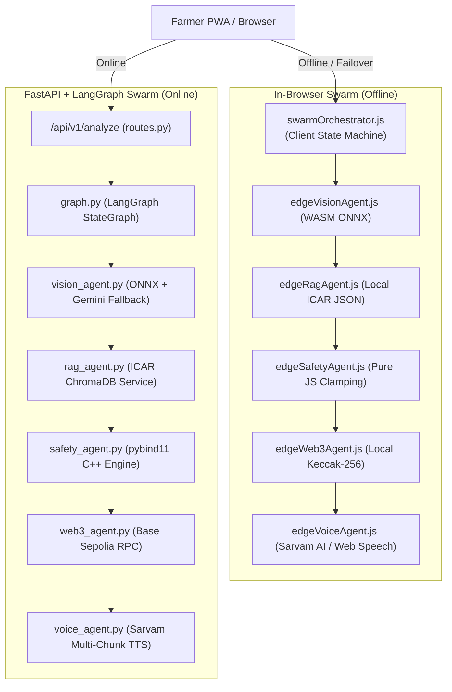

# AgriNexus: Complete Project Folder Structure & System Blueprint

This document is the single source of truth for the entire AgriNexus repository. It maps every directory, file, agent, contract, service, and component to its exact functional role.

---

## 🗺️ High-Level System Architecture

AgriNexus uses a **Hybrid Edge-to-Cloud Dual Execution Architecture**:
1. **Server Swarm (Cloud Mode):** Python 3.12 + FastAPI + LangGraph state graph with deterministic C++ safety engine and Base Sepolia L2 smart contract logging.
2. **Edge Swarm (Zero-Connectivity / PWA Mode):** 100% In-Browser execution using WebAssembly (ONNX Runtime Web), client-side agronomic RAG, pure JS safety constraints, and Web Speech API.

---

## 📂 Repository File & Directory Map

### 1. Root Directory

| File / Folder | Role & Description |
| :--- | :--- |
| `ARCHITECTURE.md` | Comprehensive architectural specification: state graphs, latency benchmarks, security interlocks, and protocols. |
| `DECISIONS.md` | Chronological Architectural Decision Records (ADRs 001–087) detailing every engineering choice and design rationale. |
| `README.md` | Public commercial overview, features, quick-start guide, and technology stack. |
| `project_folder_structure.md` | This file. Exhaustive file-by-file codebase guide and hackathon defense reference. |
| `Dockerfile` | Multi-stage production container build packaging FastAPI, static Vite assets, and compiled C++ pybind11 modules. |
| `docker-compose.yml` | Container orchestration service definition with port 8000 bindings and environment mappings. |
| `render.yaml` | Production deployment blueprint for Render cloud hosting. |
| `.dockerignore` | Build optimization rules ignoring node_modules, temp files, and virtual environments. |
| `patch.py` | Standalone operational hotfix utility script. |

---

### 2. Backend Subsystem (`/backend`)

The Python 3.12 + FastAPI + LangGraph micro-monolith responsible for AI execution, safety clamping, database persistence, and API routing.

#### Root Configuration Files
- [`backend/main.py`](file:///c:/Users/vansh/OneDrive/Desktop/AgriNexus/backend/main.py): FastAPI app factory. Configures CORS, mounts `/static` audio directories, initializes MongoDB connection, exposes `/health` endpoints, and includes API routers.
- [`backend/requirements.txt`](file:///c:/Users/vansh/OneDrive/Desktop/AgriNexus/backend/requirements.txt): Pinned backend Python dependencies (`fastapi`, `langgraph`, `langchain-google-genai`, `onnxruntime`, `web3`, `pymongo`, `edge-tts`, `httpx`).
- [`backend/pyproject.toml`](file:///c:/Users/vansh/OneDrive/Desktop/AgriNexus/backend/pyproject.toml): Modern PEP-518 build specification.
- [`backend/.env`](file:///c:/Users/vansh/OneDrive/Desktop/AgriNexus/backend/.env): Production runtime secrets (Google API key, Sarvam API key, Web3 private key, Cloudinary keys, MongoDB URI).

---

#### Backend State & Multi-Agent Swarm (`/backend/app/`)

- [`backend/app/state.py`](file:///c:/Users/vansh/OneDrive/Desktop/AgriNexus/backend/app/state.py):
  - **PRIMARY STATE STORE FOR BACKEND SWARM.**
  - Defines `AgriNexusState(TypedDict)` containing 25+ shared immutable state keys (`image_path`, `weather_data`, `vision_diagnosis`, `vision_confidence`, `is_crop_supported`, `proposed_chemical`, `safe_dosage_ml_per_acre`, `is_safe`, `nearest_kvk`, `tx_hash`, `passport_id`, `translated_text`, `vernacular_audio_url`, `vision_engine`, `identified_by`).
  - Utilizes `Annotated[List[str], operator.add]` for append-only distributed error tracking across nodes.

- [`backend/app/agents/graph.py`](file:///c:/Users/vansh/OneDrive/Desktop/AgriNexus/backend/app/agents/graph.py):
  - **LANGGRAPH STATE MACHINE ORCHESTRATOR.**
  - Compiles the 5 agent nodes (`vision`, `rag`, `safety`, `web3`, `voice`).
  - Defines the `route_after_vision` early-exit conditional gate:
    $$\text{Route to Voice} \iff (\neg S_{\mathrm{crop}}) \lor (C \lt 0.97)$$
    *(Directly routes to Agent 5 for safe organic advisory and ICAR KVK referral when `is_crop_supported == false` or confidence $C \lt 0.97$, bypassing chemical RAG, safety clamping, and blockchain passporting)*

- [`backend/app/agents/vision_agent.py`](file:///c:/Users/vansh/OneDrive/Desktop/AgriNexus/backend/app/agents/vision_agent.py):
  - **Agent 1: Vision Pathology & Dual-Gate Guard.**
  - **Tier 1 (Local):** Executes `agrinexus_vision.onnx` via `onnxruntime` with pure Numpy tensor preprocessing (`preprocess_image_for_efficientnet`). Enforces 97% confidence floor and 60% runner-up margin floor.
  - **Tier 2 (Fallback):** Engages Gemini Multi-Modal cascade (`gemini-flash-lite-latest`, `gemini-flash-latest`, `gemini-3.6-flash`) for OOD subjects.
  - Emits `vision_engine: "ONNX EfficientNet-B4"` or `vision_engine: "Gemini 1.5 Flash (Cloud Fallback)"`.

- [`backend/app/agents/rag_agent.py`](file:///c:/Users/vansh/OneDrive/Desktop/AgriNexus/backend/app/agents/rag_agent.py):
  - **Agent 2: Grounded ICAR RAG Core.**
  - Zero-hallucination semantic search against certified ICAR research protocols. Extracts active chemical, base dosage, unit, formulation, and MIC ranges. Blocks unverified chemical suggestions.

- [`backend/app/agents/safety_agent.py`](file:///c:/Users/vansh/OneDrive/Desktop/AgriNexus/backend/app/agents/safety_agent.py):
  - **Agent 3: Deterministic Safety Interlock.**
  - Python interface calling the compiled C++ pybind11 `safety_engine` module (with pure-Python mathematical safety fallback). Enforces CIB&RC bans, statutory ceilings, humidity attenuation, and MIC floors.

- [`backend/app/agents/web3_agent.py`](file:///c:/Users/vansh/OneDrive/Desktop/AgriNexus/backend/app/agents/web3_agent.py):
  - **Agent 4: Web3 Cryptographic Passport Relayer.**
  - Computes SHA-256 hashes of the image and treatment plan. Interacts with the `CropPassport.sol` smart contract on Base Sepolia L2 to mint immutable passport receipts.

- [`backend/app/agents/voice_agent.py`](file:///c:/Users/vansh/OneDrive/Desktop/AgriNexus/backend/app/agents/voice_agent.py):
  - **Agent 5: Vernacular Voice & KVK Extension Supervisor.**
  - Adapts agricultural advisories into 11 Indian regional dialects using Gemini LLM translation.
  - Sanitized prompt: strictly avoids technical AI/engine jargon, focusing on actionable farmer guidance.
  - Generates seamless spoken vernacular audio via `tts_client.py`.

---

#### Backend API Routes & WebSocket Telemetry (`/backend/app/api/`)

- [`backend/app/api/routes.py`](file:///c:/Users/vansh/OneDrive/Desktop/AgriNexus/backend/app/api/routes.py):
  - **Central API Controller.**
  - `POST /api/v1/analyze`: Uploads leaf image to Cloudinary, fetches real-time weather via GPS, executes LangGraph streaming (`agrinexus_app.astream`), broadcasts step-by-step telemetry over WebSockets, persists scan in MongoDB Atlas, and returns sanitized JSON.
  - `POST /api/v1/auth/register` & `POST /api/v1/auth/login`: JWT authentication with PBKDF2-HMAC-SHA256 password hashing.
  - `GET /api/v1/user/scans`: Historical farmer scan retrieval.
  - `POST /api/v1/tts`: Proxy text-to-speech endpoint.
  - `WebSocket /ws/telemetry`: Real-time streaming bus broadcasting laser-edge telemetry events to the 3D dashboard.

---

#### Backend Deterministic C++ Safety Engine (`/backend/app/cpp_core/`)

- [`backend/app/cpp_core/safety_engine.cpp`](file:///c:/Users/vansh/OneDrive/Desktop/AgriNexus/backend/app/cpp_core/safety_engine.cpp):
  - Sub-millisecond C++17 safety engine bound via `pybind11`.
  - Maintains `std::unordered_set` of 19 banned agrochemicals under the Indian Insecticides Act, 1968.
  - Clamps dosage against statutory ceilings (`DEFAULT_MAX_STATUTORY_DOSE = 350.0`).
  - Evaluates relative humidity ($>80\%$ triggers $10\%$ dosage attenuation) and locks dosage at Minimum Inhibitory Concentration (MIC) floor.
- [`backend/app/cpp_core/CMakeLists.txt`](file:///c:/Users/vansh/OneDrive/Desktop/AgriNexus/backend/app/cpp_core/CMakeLists.txt): CMake build rules for C++ safety library.
- [`backend/app/cpp_core/setup.py`](file:///c:/Users/vansh/OneDrive/Desktop/AgriNexus/backend/app/cpp_core/setup.py): Setuptools build script for compiling pybind11 extension (`python setup.py build_ext --inplace`).

---

#### Backend Services (`/backend/app/services/`)

- [`backend/app/services/tts_client.py`](file:///c:/Users/vansh/OneDrive/Desktop/AgriNexus/backend/app/services/tts_client.py):
  - Multi-chunk Indic speech synthesis client.
  - Splits text into $\le 450$-character chunks (`split_text_into_chunks`).
  - Merges audio using Python's standard `wave` and `io` modules (`concatenate_wav_bytes`).
  - Manages primary Sarvam AI Bulbul:v3 API requests and automated failover to Microsoft Edge Neural TTS (`edge_tts`).
- [`backend/app/services/weather_service.py`](file:///c:/Users/vansh/OneDrive/Desktop/AgriNexus/backend/app/services/weather_service.py):
  - 3-tier GPS & Meteorological resolution cascade: EXIF photo metadata $\to$ device GPS $\to$ regional baseline.
  - Queries OpenWeatherMap with automated fallback to Open-Meteo and Met.no. Computes temperature, humidity, wind velocity, rain probability, and AQI spray hazards.
- [`backend/app/services/chroma_db.py`](file:///c:/Users/vansh/OneDrive/Desktop/AgriNexus/backend/app/services/chroma_db.py):
  - ICAR protocol search engine querying certified agronomic vectors from `icar_protocols.json`.
- [`backend/app/services/kvk_service.py`](file:///c:/Users/vansh/OneDrive/Desktop/AgriNexus/backend/app/services/kvk_service.py):
  - Haversine geodesic distance resolution matching farmer coordinates to the nearest physical ICAR Krishi Vigyan Kendra (KVK) center.
- [`backend/app/services/web3_client.py`](file:///c:/Users/vansh/OneDrive/Desktop/AgriNexus/backend/app/services/web3_client.py):
  - Web3.py RPC client managing Base Sepolia L2 gasless transactions and ABI encoding for `CropPassport.sol`.
- [`backend/app/services/mongodb_service.py`](file:///c:/Users/vansh/OneDrive/Desktop/AgriNexus/backend/app/services/mongodb_service.py):
  - PyMongo Atlas connection singleton with connection pooling and DNS SRV resolution.
- [`backend/app/services/auth_service.py`](file:///c:/Users/vansh/OneDrive/Desktop/AgriNexus/backend/app/services/auth_service.py):
  - Authentication engine: PBKDF2-HMAC password hashing, salt generation, and JWT token issuance.
- [`backend/app/services/scan_service.py`](file:///c:/Users/vansh/OneDrive/Desktop/AgriNexus/backend/app/services/scan_service.py):
  - MongoDB document persistence for completed crop diagnosis and treatment records.

---

#### Backend Data & ML Model (`/backend/app/data/` & `/backend/ml_model/`)

- [`backend/app/data/icar_protocols.json`](file:///c:/Users/vansh/OneDrive/Desktop/AgriNexus/backend/app/data/icar_protocols.json): 38 verified ICAR and CIB&RC agronomic protocols specifying active ingredients, formulations, dosages, dilution volumes, and source research institutes.
- [`backend/app/data/kvk_directory.json`](file:///c:/Users/vansh/OneDrive/Desktop/AgriNexus/backend/app/data/kvk_directory.json): Geocoded registry of ICAR Krishi Vigyan Kendra extension centers across India with telephone contacts.
- [`backend/ml_model/agrinexus_vision.onnx`](file:///c:/Users/vansh/OneDrive/Desktop/AgriNexus/backend/ml_model/agrinexus_vision.onnx): Quantized EfficientNet-B4 neural network (71MB) classifying 38 agricultural foliar diseases across 14 commercial crops.
- [`backend/ml_model/class_mapping.json`](file:///c:/Users/vansh/OneDrive/Desktop/AgriNexus/backend/ml_model/class_mapping.json): 38-class index mapping dictionary.

---

#### Backend Automated Test Suite (`/backend/tests/`)

- [`backend/tests/test_tts_client.py`](file:///c:/Users/vansh/OneDrive/Desktop/AgriNexus/backend/tests/test_tts_client.py): Verifies text splitting, multi-chunk parsing, and standard library WAV audio byte concatenation.
- [`backend/tests/test_vision_gatekeeper.py`](file:///c:/Users/vansh/OneDrive/Desktop/AgriNexus/backend/tests/test_vision_gatekeeper.py): Tests 97% confidence floor, margin clamping, Gemini Tier-2 fallback, and telemetry attribution.
- [`backend/tests/test_safety_engine.py`](file:///c:/Users/vansh/OneDrive/Desktop/AgriNexus/backend/tests/test_safety_engine.py): Tests C++ safety engine banned list, statutory maximums, and MIC resistance floor.
- [`backend/tests/test_weather_service.py`](file:///c:/Users/vansh/OneDrive/Desktop/AgriNexus/backend/tests/test_weather_service.py): Tests meteorological API cascades and GPS fallback.
- [`backend/tests/test_kvk_service.py`](file:///c:/Users/vansh/OneDrive/Desktop/AgriNexus/backend/tests/test_kvk_service.py): Tests Haversine distance nearest-neighbor calculations.
- [`backend/tests/test_mongo_auth.py`](file:///c:/Users/vansh/OneDrive/Desktop/AgriNexus/backend/tests/test_mongo_auth.py) & [`test_mongo_api_routes.py`](file:///c:/Users/vansh/OneDrive/Desktop/AgriNexus/backend/tests/test_mongo_api_routes.py): Tests registration, authentication tokens, and user scan records.

---

### 3. Frontend Subsystem (`/frontend`)

Built with React 18, Vite, and Tailwind CSS. Capable of operating online with WebSocket telemetry or offline as an autonomous PWA.

#### Root Configuration Files
- [`frontend/package.json`](file:///c:/Users/vansh/OneDrive/Desktop/AgriNexus/frontend/package.json): Pinned frontend dependencies (`lucide-react`, `onnxruntime-web`, `leaflet`, `exifr`, `html2canvas`).
- [`frontend/vite.config.js`](file:///c:/Users/vansh/OneDrive/Desktop/AgriNexus/frontend/vite.config.js): Vite build configuration with proxy settings and static asset bundling.
- [`frontend/tailwind.config.js`](file:///c:/Users/vansh/OneDrive/Desktop/AgriNexus/frontend/tailwind.config.js): Custom agricultural HUD styling, laser glow animations, and responsive breakpoints.
- [`frontend/index.html`](file:///c:/Users/vansh/OneDrive/Desktop/AgriNexus/frontend/index.html): HTML root hosting viewport meta-tags and PWA manifest links.

---

#### Client-Side Edge Multi-Agent Swarm (`/frontend/src/services/`)

- [`frontend/src/services/swarmOrchestrator.js`](file:///c:/Users/vansh/OneDrive/Desktop/AgriNexus/frontend/src/services/swarmOrchestrator.js):
  - **PRIMARY STATE STORE & ORCHESTRATOR FOR CLIENT-SIDE OFFLINE SWARM.**
  - `runOfflineSwarmPipeline()` executes all 5 edge agents sequentially when offline or when the backend server is unreachable.
  - Manages `initialState` and `currentState`.
  - Dispatches `broadcastLocal(nodeName, stateUpdate)` to notify `TelemetryView` via `window.__agrinexus_telemetry_listeners`.

- [`frontend/src/services/edgeVisionAgent.js`](file:///c:/Users/vansh/OneDrive/Desktop/AgriNexus/frontend/src/services/edgeVisionAgent.js):
  - **In-Browser Edge AI Agent 1.**
  - Runs `agrinexus_vision.onnx` inside the browser via WebAssembly (`onnxruntime-web`).
  - Pre-screens images using sub-2ms Canvas chlorophyll pigment heuristic (`checkOrganicChlorophyllContent`).
  - Enforces 97% confidence floor and 60% margin floor. Emits `vision_engine: "ONNX EfficientNet-B4"`.

- [`frontend/src/services/edgeRagAgent.js`](file:///c:/Users/vansh/OneDrive/Desktop/AgriNexus/frontend/src/services/edgeRagAgent.js):
  - **In-Browser RAG Agent 2.**
  - Performs local semantic token search against `icar_protocols.json` embedded in the client bundle.

- [`frontend/src/services/edgeSafetyAgent.js`](file:///c:/Users/vansh/OneDrive/Desktop/AgriNexus/frontend/src/services/edgeSafetyAgent.js):
  - **In-Browser Safety Agent 3.**
  - Deterministic JavaScript port of the C++ safety engine. Checks 19 CIB&RC banned chemicals, statutory dosage ceilings, humidity attenuation, and MIC protection.

- [`frontend/src/services/edgeWeb3Agent.js`](file:///c:/Users/vansh/OneDrive/Desktop/AgriNexus/frontend/src/services/edgeWeb3Agent.js):
  - **In-Browser Web3 Agent 4.**
  - Generates cryptographic SHA-256 / Keccak hashes of diagnostic and prescription parameters for local passport creation.

- [`frontend/src/services/edgeVoiceAgent.js`](file:///c:/Users/vansh/OneDrive/Desktop/AgriNexus/frontend/src/services/edgeVoiceAgent.js):
  - **In-Browser Voice Agent 5.**
  - Generates localized multi-chunk speech via Sarvam AI (`synthesizeSarvamSpeech`) with client-side binary WAV concatenation (`mergeWavBase64List`).
  - Manages automated fallback to mobile internal speech (`speakVernacularOffline`) on quota exhaustion.

- [`frontend/src/services/api.js`](file:///c:/Users/vansh/OneDrive/Desktop/AgriNexus/frontend/src/services/api.js):
  - Network dispatcher. `uploadImage()` detects online status: routes to backend `/api/v1/analyze` when online; seamlessly fails over to `runOfflineSwarmPipeline()` if offline or unreachable.
  - Manages WebSocket connection (`createTelemetrySocket`) with mock fallback for local events.

- [`frontend/src/services/auth.js`](file:///c:/Users/vansh/OneDrive/Desktop/AgriNexus/frontend/src/services/auth.js):
  - Client-side token storage, profile state, and login/register network calls.

---

#### UI Components (`/frontend/src/components/`)

- [`frontend/src/components/FarmerView.jsx`](file:///c:/Users/vansh/OneDrive/Desktop/AgriNexus/frontend/src/components/FarmerView.jsx):
  - Primary user interface for farmers. Features one-tap image capture, webcam integration, meteorological weather HUD, vernacular audio playback bar, safety warnings, and KVK contact cards.
- [`frontend/src/components/TelemetryView.jsx`](file:///c:/Users/vansh/OneDrive/Desktop/AgriNexus/frontend/src/components/TelemetryView.jsx):
  - 3D Multi-Agent Swarm Telemetry Control Room. Renders interactive laser paths connecting active nodes and displays live telemetry logs with dynamic `Engine: ONNX EfficientNet-B4` vs. `Engine: Gemini 1.5 Flash` attribution.
- [`frontend/src/components/AdminDashboard.jsx`](file:///c:/Users/vansh/OneDrive/Desktop/AgriNexus/frontend/src/components/AdminDashboard.jsx):
  - Agricultural extension supervisor dashboard showing scan metrics, disease distributions, and regional map pins.
- [`frontend/src/components/AuthView.jsx`](file:///c:/Users/vansh/OneDrive/Desktop/AgriNexus/frontend/src/components/AuthView.jsx):
  - Farmer authentication modal (Login / Registration / Guest Bypass).
- [`frontend/src/components/UserScansModal.jsx`](file:///c:/Users/vansh/OneDrive/Desktop/AgriNexus/frontend/src/components/UserScansModal.jsx):
  - Historical diagnosis archive displaying previously analyzed crops, prescriptions, and BaseScan transaction links.
- [`frontend/src/components/MapModal.jsx`](file:///c:/Users/vansh/OneDrive/Desktop/AgriNexus/frontend/src/components/MapModal.jsx):
  - Interactive Leaflet map displaying real-time field coordinates, weather stations, and the nearest KVK center.
- [`frontend/src/components/LaptopWebcamModal.jsx`](file:///c:/Users/vansh/OneDrive/Desktop/AgriNexus/frontend/src/components/LaptopWebcamModal.jsx):
  - Direct desktop webcam interface with live canvas video streaming.
- [`frontend/src/components/PwaInstallBanner.jsx`](file:///c:/Users/vansh/OneDrive/Desktop/AgriNexus/frontend/src/components/PwaInstallBanner.jsx):
  - Native PWA installation banner prompt (`beforeinstallprompt`).

---

### 4. Smart Contracts Subsystem (`/contracts`)

Decentralized immutable crop provenance on Ethereum Layer-2 (Base Sepolia).

- [`contracts/contracts/CropPassport.sol`](file:///c:/Users/vansh/OneDrive/Desktop/AgriNexus/contracts/contracts/CropPassport.sol):
  - Solidity 0.8.20 contract inheriting OpenZeppelin `Ownable`.
  - Defines `PassportRecord`: `timestamp`, `imageHash`, `diagnosis`, `treatmentHash`, and `isSafe`.
  - Emits `PassportCreated` events for transparent verifiable ledger auditing.
- [`contracts/scripts/deploy.js`](file:///c:/Users/vansh/OneDrive/Desktop/AgriNexus/contracts/scripts/deploy.js):
  - Hardhat deployment script for Base Sepolia testnet.
- [`contracts/hardhat.config.js`](file:///c:/Users/vansh/OneDrive/Desktop/AgriNexus/contracts/hardhat.config.js):
  - Hardhat configuration specifying Solidity version, optimizer settings (200 runs), and Base Sepolia network RPC endpoints.
- [`contracts/test/CropPassport.test.js`](file:///c:/Users/vansh/OneDrive/Desktop/AgriNexus/contracts/test/CropPassport.test.js):
  - Automated unit test suite verifying contract deployment, access controls, passport creation, and event emission.

---

### 5. ML Pipeline Subsystem (`/ml_pipeline`)

- [`ml_pipeline/train_efficientnet.py`](file:///c:/Users/vansh/OneDrive/Desktop/AgriNexus/ml_pipeline/train_efficientnet.py):
  - PyTorch training script for EfficientNet-B4 on the 38-class PlantVillage / ICAR foliar pathology dataset.
  - Generates `agrinexus_vision.onnx` with Dynamic Quantization.
- [`ml_pipeline/train_and_evaluate.py`](file:///c:/Users/vansh/OneDrive/Desktop/AgriNexus/ml_pipeline/train_and_evaluate.py):
  - Evaluates test accuracy, confusion matrices, Top-1 and Top-5 accuracy, and exports ONNX classification runtime metrics.

---

## ⚡ Quick Reference: "Where is [X] Located?"

| Operational Question | Exact File(s) to Cite |
| :--- | :--- |
| **"Where is the state managed on the client/frontend?"** | [`frontend/src/services/swarmOrchestrator.js`](file:///c:/Users/vansh/OneDrive/Desktop/AgriNexus/frontend/src/services/swarmOrchestrator.js) (`currentState`, `initialState`, `broadcastLocal`) |
| **"Where is the state managed on the backend/server?"** | [`backend/app/state.py`](file:///c:/Users/vansh/OneDrive/Desktop/AgriNexus/backend/app/state.py) (`AgriNexusState`) & [`backend/app/agents/graph.py`](file:///c:/Users/vansh/OneDrive/Desktop/AgriNexus/backend/app/agents/graph.py) (`StateGraph`) |
| **"Where is the 97% confidence gate / fallback logic?"** | [`backend/app/agents/vision_agent.py`](file:///c:/Users/vansh/OneDrive/Desktop/AgriNexus/backend/app/agents/vision_agent.py#L96) & [`frontend/src/services/edgeVisionAgent.js`](file:///c:/Users/vansh/OneDrive/Desktop/AgriNexus/frontend/src/services/edgeVisionAgent.js#L179) |
| **"Where are chemicals banned and dosages clamped?"** | [`backend/app/cpp_core/safety_engine.cpp`](file:///c:/Users/vansh/OneDrive/Desktop/AgriNexus/backend/app/cpp_core/safety_engine.cpp) (C++ pybind11) & [`frontend/src/services/edgeSafetyAgent.js`](file:///c:/Users/vansh/OneDrive/Desktop/AgriNexus/frontend/src/services/edgeSafetyAgent.js) |
| **"Where are the official ICAR agronomy protocols stored?"** | [`backend/app/data/icar_protocols.json`](file:///c:/Users/vansh/OneDrive/Desktop/AgriNexus/backend/app/data/icar_protocols.json) & [`frontend/src/data/icar_protocols.json`](file:///c:/Users/vansh/OneDrive/Desktop/AgriNexus/frontend/src/data/icar_protocols.json) |
| **"Where is the smart contract located?"** | [`contracts/contracts/CropPassport.sol`](file:///c:/Users/vansh/OneDrive/Desktop/AgriNexus/contracts/contracts/CropPassport.sol) |
| **"Where is text-to-speech audio generated without cutoffs?"** | [`backend/app/services/tts_client.py`](file:///c:/Users/vansh/OneDrive/Desktop/AgriNexus/backend/app/services/tts_client.py) (`split_text_into_chunks`, `concatenate_wav_bytes`) |
| **"Where is the telemetry laser animation rendered?"** | [`frontend/src/components/TelemetryView.jsx`](file:///c:/Users/vansh/OneDrive/Desktop/AgriNexus/frontend/src/components/TelemetryView.jsx) |
| **"Where is weather resolved and AQI checked?"** | [`backend/app/services/weather_service.py`](file:///c:/Users/vansh/OneDrive/Desktop/AgriNexus/backend/app/services/weather_service.py) & [`frontend/src/services/swarmOrchestrator.js`](file:///c:/Users/vansh/OneDrive/Desktop/AgriNexus/frontend/src/services/swarmOrchestrator.js#L26) |
